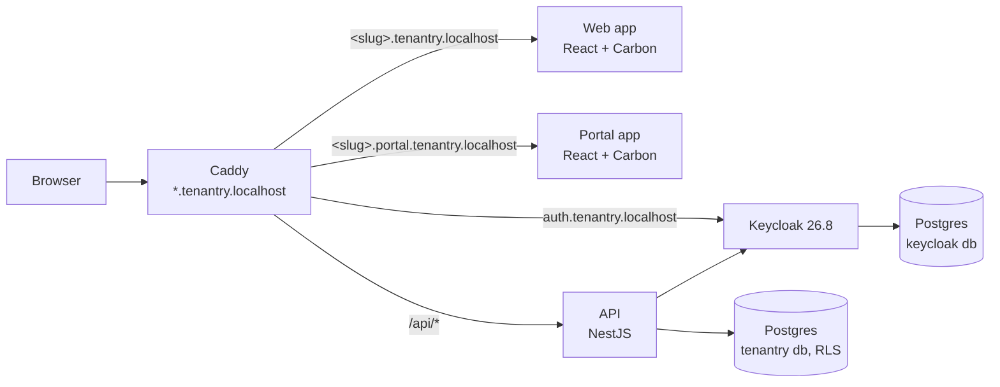

# Tenantry

Tenantry is an open-source, multi-tenant identity platform on Keycloak 26.8. It has two tenant tiers:

- **Standard** tenants are organizations in one shared realm. Their users sign in once and move between our products.
- **Enterprise** tenants each get their own realm, created by script from a versioned template. That gives them stronger isolation, their own login policies and their own connected apps.

One codebase serves both tiers, and the application code never needs to know which tier a tenant is on.

> **Status:** v0.1 (Phases 0–2) plus Phase 3. Standard tenants work end to end: signup, members and roles, the audit log, single sign-on across two apps with single logout, workspace switching, tenant branding on the apps and the login page, and company login linked after a DNS proof. Enterprise tenants get a realm of their own, built and kept up to date from a versioned template by `pnpm ops enterprise`, and the API accepts only that realm's tokens for them. The Phase 1 to 3 guarantees are tested in CI. What does not work yet is in [docs/known-issues.md](docs/known-issues.md). See the [roadmap](#roadmap).

## Guarantees

These are the project's promises. Each one is an automated test that runs in CI against real Keycloak and Postgres containers (`pnpm test:isolation`). Until its phase lands, a row stays _planned_.

| Guarantee                                                   | Expected result                                             | Phase | Status  |
| ----------------------------------------------------------- | ----------------------------------------------------------- | ----- | ------- |
| Tenant A user requests tenant B data with A's token         | 404 (the row is invisible to A)                             | 1     | tested  |
| Tenant A user calls B's subdomain with A's token            | 403                                                         | 1     | tested  |
| A query that forgets the tenant filter                      | Returns only the current tenant's rows (row-level security) | 1     | tested  |
| App database role tries to bypass row-level security        | Not allowed; the role does not own the tables               | 1     | tested  |
| User is admin in org A and member in org B, acts in B       | Treated as member                                           | 1     | tested  |
| Client sends a tenant id header that differs from the token | Ignored; the token decides                                  | 1     | tested  |
| Member tries to invite, remove or change roles              | 403                                                         | 1     | tested  |
| Logout in one app                                           | Session ends in the other app                               | 2     | tested  |
| Domain link without a verified DNS record                   | Refused                                                     | 2     | tested  |
| Valid token from another enterprise realm                   | 401 (issuer rule)                                           | 3     | tested  |
| Valid token from the shared realm on an enterprise tenant   | 401                                                         | 3     | tested  |
| Token for the wrong audience                                | 401                                                         | 3     | tested  |
| Enterprise realm token on a Standard workspace              | 401                                                         | 3     | tested  |
| Password grant in an enterprise realm                       | Refused by the realm's client policy                        | 3     | tested  |
| Company login brings an email outside the verified domain   | Refused by Keycloak                                         | 3     | tested  |
| Customer registers a wildcard or non-HTTPS redirect URI     | Refused by our API and by Keycloak client policy            | 4     | planned |
| Tenant A admin registers or edits an app in tenant B        | 403                                                         | 4     | planned |
| User of another tenant signs in to a customer app           | Refused                                                     | 4     | planned |
| Migrated tenant's user signs in through the new realm       | Same user id and data                                       | 5     | planned |

## Quick start

You need Docker Desktop, Node 22+ and pnpm 10.

```bash
pnpm install
```

```bash
pnpm dev:stack
```

Then open <http://demo.tenantry.localhost>. Any subdomain works as a tenant slug. The portal is at <http://demo.portal.tenantry.localhost>.

- **Keycloak admin:** <http://auth.tenantry.localhost>, with the credentials in `.env`. The first run creates `.env` from `.env.example`.
- **Mailpit** (catches outgoing email): <http://mail.tenantry.localhost>.
- **Check the stack:** `pnpm smoke`.
- **Port 80, 5432 or 8180 already in use?** `pnpm dev:stack` names the variable to change. Set `TENANTRY_HTTP_PORT` and add the port to `TENANTRY_AUTH_URL`. Or set `TENANTRY_PG_PORT` and the port in `DATABASE_URL` and `DATABASE_OWNER_URL`. Or set `TENANTRY_KC_PORT` and `TENANTRY_AUTH_INTERNAL_URL`. Then rerun. URLs then include the port, for example `http://demo.tenantry.localhost:8080`. Every port listens on `127.0.0.1` only.
- **Day-to-day development:** `pnpm dev` runs Keycloak, Postgres, Caddy and Mailpit in Docker, and the API and both apps on your machine with hot reload.

`*.localhost` names resolve to your own machine in Chrome, Edge and Firefox, with no hosts-file edits.

## Try it

The quickest way is the seeded demo, which follows [docs/demo-script.md](docs/demo-script.md):

```bash
pnpm seed
```

It creates the workspaces `acme` (blue) and `globex` (green) and their people, all with the password `SEED_PASSWORD` from `.env`. `pat@example.test` belongs to both. It also links `acme.test` to the stand-in company sign-in, so `alice@acme.test` signs in to `acme` through it. And it provisions the enterprise workspace `initech` in its own realm, `ent-initech`, whose owner `owner@initech.test` signs in at <http://initech.tenantry.localhost> with the same password.

Or start from nothing, with the stack running (`pnpm dev:stack`; add `:8080`, or your port, to these addresses if port 80 was taken):

1. Open <http://tenantry.localhost>, choose **Register**, create an account, and confirm it with the link Keycloak emails to Mailpit (<http://mail.tenantry.localhost>).
2. The **Create your workspace** wizard asks for a name and an address. Create `acme`.
3. You land on <http://acme.tenantry.localhost>, signed in as the owner.
4. Under **Members**, invite someone as Admin. The invite email arrives in Mailpit at <http://mail.tenantry.localhost>.
5. Sign out, follow the email's link, register as that person, and confirm the address the same way. At `acme.tenantry.localhost` they are an Admin.
6. **Audit log** lists `tenant.created`, `member.invited` and `member.joined`. **Projects** is the row-level security example.
7. Open the portal at <http://acme.portal.tenantry.localhost>: you are signed in already. As the owner, set a colour and a logo under **Branding**. They show in both apps and on the login page.

## Architecture



The subdomain picks the tenant, and the token must prove it. Every request becomes one tenant context at a single guard. Postgres row-level security is the second isolation layer, so one missing filter cannot leak data.

## Standard vs Enterprise tenants

| Capability                          | Standard (shared realm)                       | Enterprise (dedicated realm)   |
| ----------------------------------- | --------------------------------------------- | ------------------------------ |
| Lives in                            | An organization in the `platform` realm       | Its own realm, e.g. `ent-acme` |
| SSO across our products             | Yes, and across all tenants a user belongs to | Yes, within the tenant's realm |
| Company login (Entra, Okta, Google) | Yes, linked by verified email domain          | Yes, configured in their realm |
| Login page branding                 | Logo and colour per tenant                    | Full custom theme              |
| MFA, password and session rules     | Platform defaults                             | Their own                      |
| Connect their own apps              | No                                            | Yes, through our portal        |
| SCIM from their directory           | No                                            | Yes, Keycloak native per realm |
| Users in several tenants            | One account                                   | Separate account per realm     |
| Scale                               | Thousands of tenants                          | Tens to low hundreds of realms |

Phase 3 delivers the enterprise realm, its template and its sign-in. Connecting customer apps, SCIM and per-tenant policies follow in Phases 4 and 5.

## Repository

| Path                      | What it holds                                             |
| ------------------------- | --------------------------------------------------------- |
| `apps/api`                | NestJS API: the auth guard, tenants, members, apps, audit |
| `apps/web`, `apps/portal` | The two React apps used to demonstrate SSO                |
| `apps/login-theme`        | The Keycloak login theme (Keycloakify, Carbon)            |
| `apps/ops`                | Operator commands: enterprise realms, company login, seed |
| `packages/app-kit`        | What both apps share: sign-in, API client, who is in      |
| `packages/brand`          | Colour maths for tenant branding                          |
| `packages/ui`             | Carbon setup, app shell and the five page patterns        |
| `packages/db`             | Drizzle schema, migrations, row-level security            |
| `packages/auth`           | Tenant context and the role-to-permission map             |
| `packages/keycloak-admin` | The only code that calls Keycloak's admin APIs; templates |
| `infra/`                  | Docker Compose, Caddy, Keycloak realm and Postgres setup  |
| `docs/decisions/`         | [Architecture decision records](docs/decisions/README.md) |

## Roadmap

| Phase | Delivers                                                                         |
| ----- | -------------------------------------------------------------------------------- |
| 0     | Foundations: decisions, monorepo, one-command stack, CI                          |
| 1     | Standard tenant core: signup, auth guard, row-level security, members, audit log |
| 2     | SSO across both apps, tenant switching, branding → **v0.1**                      |
| 3     | Enterprise realm provisioning from versioned templates                           |
| 4     | Customer applications registered through the portal                              |
| 5     | SCIM, per-tenant policies, Standard → Enterprise migration                       |
| 6     | Production hardening and realm-count measurements → **v1.0**                     |

## Licence

[MIT](LICENSE)
