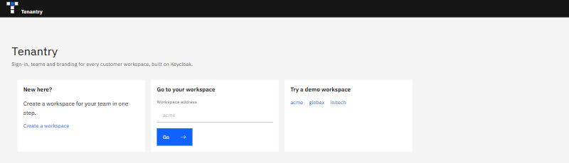
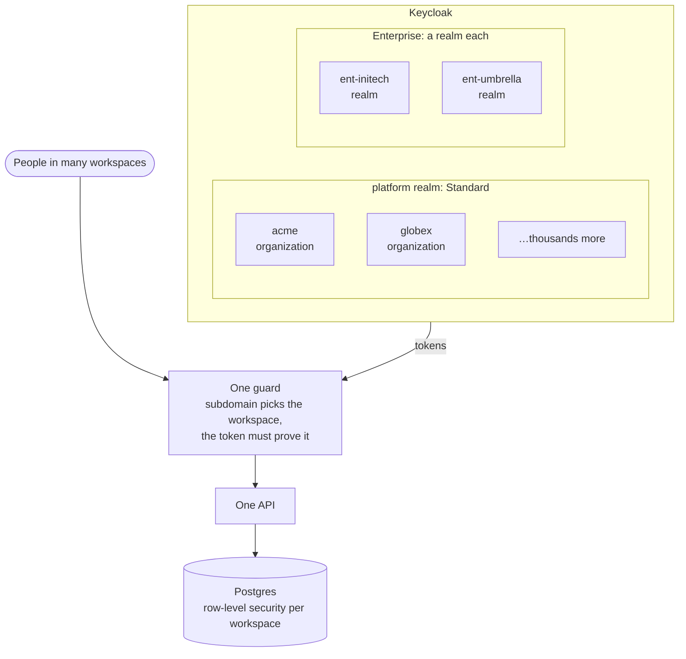
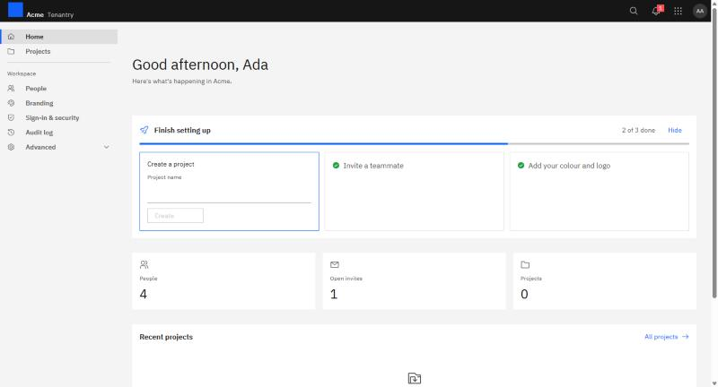
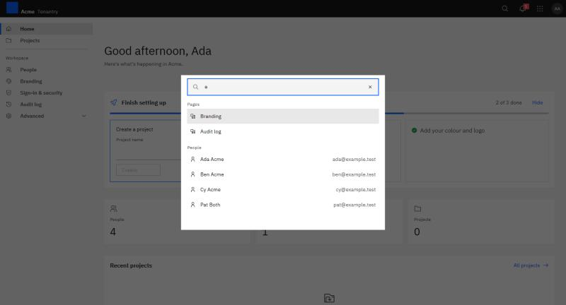
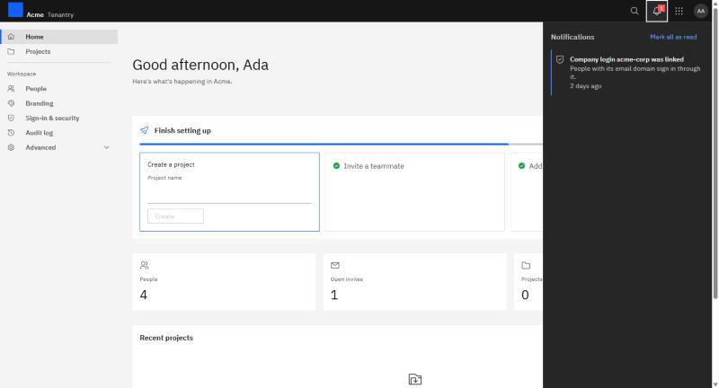
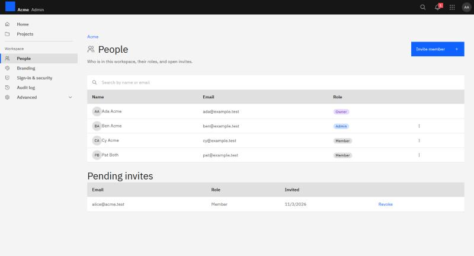
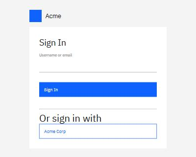
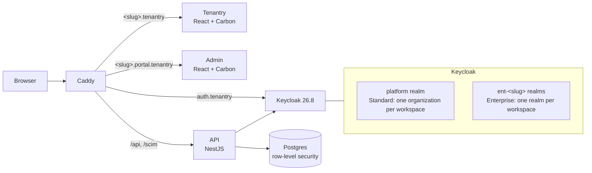

<div align="center">

<picture>
  <source media="(prefers-color-scheme: dark)" srcset="packages/ui/assets/brand/tenantry-logo-dark.svg">
  
</picture>

**Multi-tenant sign-in, teams and branding for SaaS, built on Keycloak.**

[](https://github.com/mfurqanwork/tenantry-keycloak-multitenancy/actions/workflows/ci.yml)
[](LICENSE)
[](https://www.keycloak.org/)
[](https://nodejs.org/)
[](https://www.typescriptlang.org/)

<sub><b>Built with</b></sub><br>

[](https://www.typescriptlang.org/)
[](https://nodejs.org/)
[](https://nestjs.com/)
[](https://react.dev/)
[](https://vite.dev/)
[](https://carbondesignsystem.com/)
[](https://www.keycloak.org/)
[](https://www.keycloakify.dev/)
[](https://www.postgresql.org/)
[](https://orm.drizzle.team/)
[](https://www.docker.com/)
[](https://caddyserver.com/)
[](https://turborepo.com/)
[](https://pnpm.io/)
[](https://vitest.dev/)

</div>



## The problem

Every B2B SaaS product ends up building the same things for each customer: their own sign-in page, teams with roles, a brand, login through the customer's own company identity provider, and directory sync from their IT. Then the biggest customers ask for more: their own security rules, their own apps on the same login, an isolated realm.

Doing that by hand on Keycloak means one realm per customer from day one (expensive, and it doesn't scale to thousands) or one shared realm forever (and no way to give a big customer their own). Either way, one missing filter can leak one customer's data to another.

**Tenantry** is a working, tested answer: two tiers on one codebase, with isolation enforced at the token, the API and the database.

- **Standard** workspaces are organizations in one shared realm: cheap, instant, single sign-on across every workspace a person belongs to.
- **Enterprise** workspaces get a realm of their own, built and upgraded from a versioned template, with their own security rules, apps and directory sync. A Standard workspace can move to Enterprise without anyone losing their account.



The application code never needs to know which tier a workspace is on.

## Features

### Workspaces and teams

Sign up and create a workspace in one screen. Invite people by email, give them a role (owner, admin, member), and see every change in the audit log. Home greets you with a setup card that walks a new owner through the first minute, the workspace's numbers, and the latest projects.



### Search and notifications

Search pages, people and projects from the header, or press Ctrl+K. The bell tells you what changed: who joined, your role, security settings, a directory token about to expire, and invites from other workspaces. Each person sees only what their role allows.





### One sign-in, two apps

**Tenantry** is the product people use; **Admin** is where owners and admins manage the workspace. They share one menu and one sign-in, live on separate addresses, and signing out of one signs you out of both.



### Branding

Each workspace sets a colour and a logo. Tenantry refuses a colour that white text can't be read on, and suggests a darker shade. The apps and the workspace's own login page take the brand.



### Company login

Link a customer's Entra ID, Okta or Google Workspace to their workspace once they prove they own their email domain with a DNS record. People with that domain are sent to their company's sign-in.

### Enterprise

- A realm per customer, built from a versioned template and upgraded with a dry run first.
- **Customer apps:** customers register their own web, single-page, mobile and machine-to-machine apps on their realm, with secrets shown once, rotation and a test sign-in.
- **Directory sync (SCIM)** from Entra ID or Okta, through a Tenantry gateway.
- **Sign-in & security:** two-step sign-in, password, session and lockout rules per workspace.
- **Keycloak console access** for the customer's own admins, limited to people and groups, with owners protected.
- **Move to Enterprise:** an operator command moves a Standard workspace into its own realm, and everyone keeps their account, role and data.

## How it keeps tenants apart

Every promise is an automated test that runs in CI against real Keycloak and Postgres. A few of them:

| What someone tries                                         | What happens                                      |
| ---------------------------------------------------------- | ------------------------------------------------- |
| A user of workspace A asks for workspace B's data          | 404: the row is invisible to them                 |
| A query forgets the workspace filter                       | Postgres row-level security returns only A's rows |
| A client sends a different workspace id than its token's   | Ignored: the token decides                        |
| A token from another Enterprise realm                      | 401                                               |
| A token issued to a customer's app, used on Tenantry's API | 401                                               |
| A console user tries to change an owner                    | 403                                               |

All 33 guarantees are in [tests/isolation](tests/isolation/README.md).

## Architecture



The subdomain picks the workspace and the token must prove it. One guard turns every token, from either tier, into the same tenant context. Postgres row-level security is the second layer, so one missing filter cannot leak data. The [decision records](docs/decisions/README.md) explain each choice.

## Try it in five minutes

You need Docker Desktop, Node 22 and pnpm 10.

```bash
pnpm install
```

```bash
pnpm dev:stack
```

```bash
pnpm seed
```

Then open <http://tenantry.localhost> and pick a demo workspace. The accounts, the ports and what to do when one is taken are in [docs/SETUP.md](docs/SETUP.md), and a two-minute walkthrough is in the [demo script](docs/demo-script.md).

## Documentation

- [Setting up locally](docs/SETUP.md): addresses, demo accounts, commands, tests, common problems
- Guides: [connect your app](docs/guides/connect-your-app.md), [connect SCIM](docs/guides/connect-scim.md), [move a workspace to Enterprise](docs/guides/move-to-enterprise.md)
- [Decision records](docs/decisions/README.md)
- [Demo script](docs/demo-script.md)
- [Known issues](docs/known-issues.md)
- [Brand](docs/brand.md)
- [Contributing](CONTRIBUTING.md) and [AGENTS.md](AGENTS.md) (the rules every change follows)

## Roadmap

| Phase | Delivers                                                                         | Status |
| ----- | -------------------------------------------------------------------------------- | ------ |
| 0–2   | Foundations, the Standard workspace core, single sign-on and branding → **v0.1** | Done   |
| 3–4   | Enterprise realms from versioned templates; customer apps                        | Done   |
| 5     | SCIM, security settings, console access, moving to Enterprise                    | Done   |
| 6a    | A simpler Tenantry: Tenantry and Admin, the welcome page, the brand              | Done   |
| 6b    | Running in production: TLS, backups, health, metrics, rate limits                | Next   |
| 6c    | Load test at 50, 100 and 200 realms, security review, docs site → **v1.0**       | Later  |

## Licence

[MIT](LICENSE)
